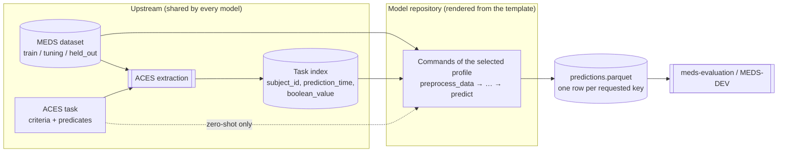

# MEDS model template

The MEDS model template is a [Copier](https://copier.readthedocs.io) template for packaging a clinical
prediction model as a repository that anyone can run, compare, and audit the same way. You render a new
repository from it, implement your model inside a fixed set of commands, and get, for free, the parts
that make models comparable: a standard input and output, artifact manifests with measurements, MEDS-DEV
registration, a SLURM interface, and a staged test workflow ending in a full-data run.

!!! note "Who this site is for"
    The repository's `README.md`, `AGENTS.md` and `SPEC.md` are written as instructions for coding
    agents that port models. This site explains the same contract to people: model implementers,
    reviewers, and benchmark organizers. The [specification](reference/spec.md) remains the normative
    source; where this site and the spec differ, the spec wins.

## The picture in one diagram



Everything left of the model repository is built **once, upstream**: the dataset, the task definition,
and the cohort (which patients, at which prediction times, with which labels). Every model receives the
same inputs and must return one prediction for every requested `(subject_id, prediction_time)`. That is
what makes results comparable.

## Fixed by the contract, owned by the model

| Fixed by the contract | Owned by the model |
|---|---|
| Inputs: a split-sharded MEDS dataset, a task index, optional dataset predicates, and (zero-shot) an ACES task | Preprocessing, featurization, tokenization |
| Six **model profiles**, each a fixed sequence of commands | Architecture, framework, batching, hardware |
| Standard command arguments (`external_meds_dir`, `output_predictions_dir`, …) | Intermediate payload formats (checkpoints, embeddings, caches) |
| A `manifest.yaml` envelope on every artifact, written last and published with rollback | How the payload inside an artifact is laid out |
| Wall time and memory measurements on every command | How fast the model is |
| Final predictions in the meds-evaluation schema, keyed and complete | How probabilities are computed |
| `models/<profile>/model.yaml` for MEDS-DEV, SLURM scripts, GitHub result sync | The command strings inside them, once finalized |

The contract fixes **boundaries**, not methods. A model can be a PyTorch transformer, a gradient-boosted
tree, an external executable or a call to a service; the template only cares that each command consumes
the right artifacts and publishes the right one.

## Where to go next

- New to the template? Read [Concepts](concepts.md), then [Choosing a profile](profiles.md).
- Porting a zero-shot model? Read [Zero-shot in practice](zero-shot.md).
- Running or reviewing a port? Read [Workflow](workflow.md) and [Running a model](running.md).
- Need the exact rule? Go to the [specification](reference/spec.md).

## Preview this site locally

```bash
uv run --group docs mkdocs serve
```
