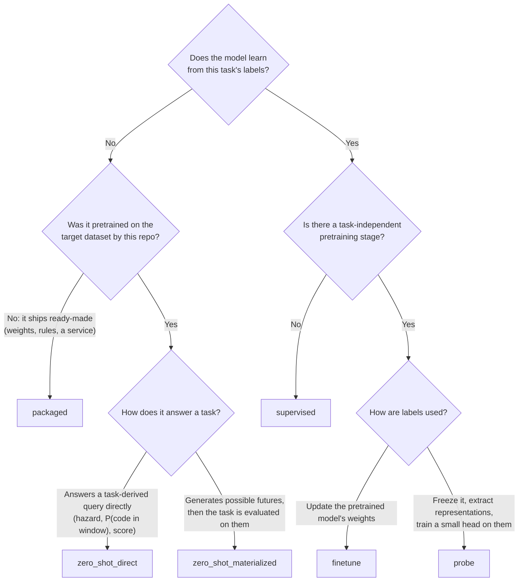
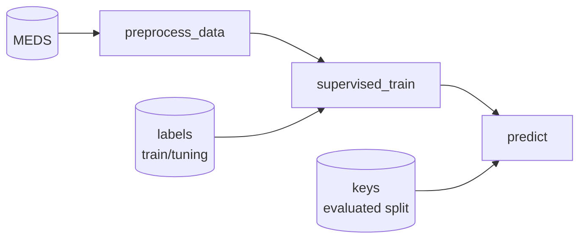
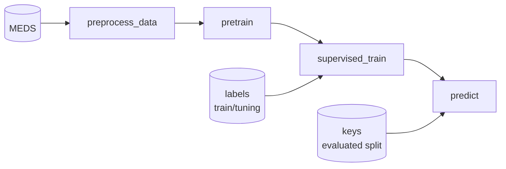
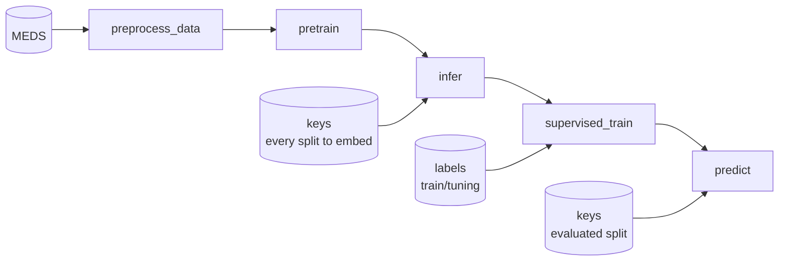
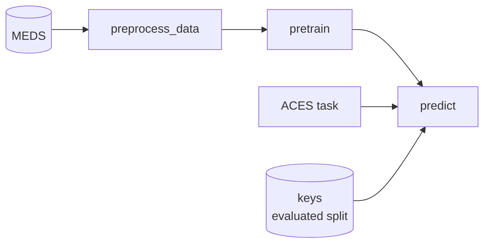
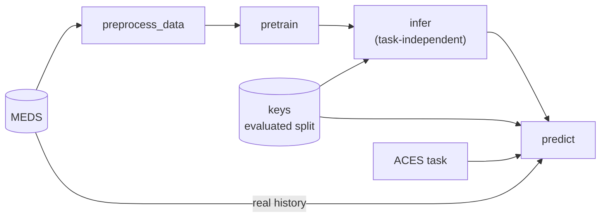
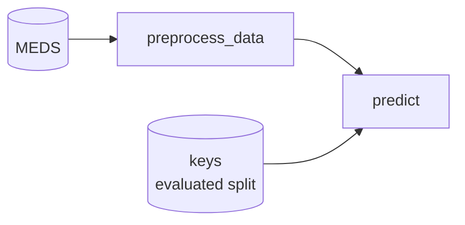

# Choosing a model profile

A **model profile** is a fixed sequence of commands. Every repository selects exactly one when it is
rendered (`copier copy … --data profile=…`). A profile describes the model's *lifecycle* — what it needs to
be trained and how it predicts — not its architecture or backend. Commands outside the selected profile are
unsupported, not silent no-ops.

| Profile | Commands, in dependency order |
|---|---|
| `supervised` | `preprocess_data` → `supervised_train` → `predict` |
| `finetune` | `preprocess_data` → `pretrain` → `supervised_train` → `predict` |
| `probe` | `preprocess_data` → `pretrain` → `infer` → `supervised_train` → `predict` |
| `zero_shot_direct` | `preprocess_data` → `pretrain` → `predict` |
| `zero_shot_materialized` | `preprocess_data` → `pretrain` → `infer` → `predict` |
| `packaged` | `preprocess_data` → `predict` |

## Profiles and example models

| Profile | What the model does | Examples |
|---|---|---|
| `supervised` | learns the task from its labels, from scratch | MEDS-Tab (logistic regression / XGBoost on tabular features), ICU-XGBoost, RETAIN, TECO, MEDS-EIC-AR trained supervised |
| `finetune` | pretrains on the dataset without labels, then updates its weights on the task's labels | MOTOR, BEHRT, DuETT, MEDS-EIC-AR (pretrained then fine-tuned) |
| `probe` | pretrains, freezes, extracts representations at the prediction times, trains a small head on them | MOTOR linear probe and other frozen-representation heads, iCareFM, ORA |
| `zero_shot_direct` | pretrains, then answers a query derived from the task directly, with no labels | MOTOR used zero-shot (time-to-event hazards), EveryQuery (code-in-window queries) |
| `zero_shot_materialized` | pretrains a generator, samples future trajectories without the task, then evaluates the task on them | MEDS-EIC-AR used zero-shot (sampled future trajectories + ACES) |
| `packaged` | arrives ready-made and is not trained here | no example ported yet — e.g. a published risk score, or an externally trained model shipped with its weights |

The same model can appear under several profiles: the profile describes how it is *used*, not what it is.

## Which profile fits my model?

Pick the profile that matches the source model's **actual** training and prediction lifecycle, and record
why in `IMPLEMENTATION_REPORT.md`. Do not pick a shorter profile to avoid implementing a stage.

## Commands at a glance

The task index is one table of keys `(subject_id, prediction_time)` plus a label column. Which part of it a
command may read is fixed:

| Command | Publishes | Reads from the index | Receives the task? |
|---|---|---|---|
| `preprocess_data` | `patients` | nothing | no |
| `pretrain` | `pretrained_model` (task-independent) | nothing | no |
| `infer` | `inference` (task-independent, at the requested timepoints) | **keys only**, for the split it processes | no |
| `supervised_train` | `supervised_model` | **keys and labels of the training (and tuning) split only** | no (learned from the labels) |
| `predict` | `predictions` | **keys only**, for the evaluated split; labels only through `attach_ground_truth` once every probability is final ([the one rule](concepts.md#reading-labels-the-one-rule)) | zero-shot only |

## The profiles one by one

In the diagrams, *labels (train/tuning)* is the label column of the training and tuning rows, read only by
`supervised_train`; *keys (evaluated split)* is the `(subject_id, prediction_time)` columns of the rows to
predict, read by `infer` and `predict`. Both come from the same upstream index.

### supervised

A model trained from scratch on the task's labels. Examples: MEDS-Tab (logistic regression or XGBoost on
tabular features), ICU-XGBoost, RETAIN, TECO, MEDS-EIC-AR trained supervised.

### finetune

A foundation model pretrained on the dataset without labels, then fine-tuned end to end on the task.
Examples: MOTOR, BEHRT, DuETT, MEDS-EIC-AR (pretrained then fine-tuned).

### probe

A frozen foundation model whose representations at the prediction times are extracted once (`infer`), then
a light head is trained on them. Examples: a MOTOR linear probe and other frozen-representation heads,
iCareFM, ORA.

### zero_shot_direct

A pretrained model that **answers a query derived from the task directly**, without any labels. `predict`
translates the task into the model's queries, runs the model, and decodes probabilities. Examples: MOTOR
used zero-shot (time-to-event hazards), EveryQuery (code-in-window queries).

### zero_shot_materialized

A pretrained **generative** model that samples possible futures. `infer` generates futures at the index's
prediction times *without knowing the task*, so one `infer` run serves every task over the same index.
`infer` publishes its own `inference` artifact next to the data artifact, never inside it. `predict`
evaluates the ACES task on the real history plus each generated future and reports the fraction of futures
in which the label is true. Example: MEDS-EIC-AR used zero-shot (sampled future trajectories + ACES).

### packaged

A model that arrives ready-made and is not trained here: a published risk score, a rule-based score, or an
externally trained model shipped with its weights. Only data preparation and prediction run in the
repository. No example has been ported yet.

## Direct vs materialized: the distinction that matters

The two zero-shot profiles are not two ways of organizing the same code; they are two kinds of model.

| | `zero_shot_direct` | `zero_shot_materialized` |
|---|---|---|
| The model | answers a query: a hazard, a probability, a score | generates (*materializes*) possible futures |
| Examples | MOTOR, EveryQuery | MEDS-EIC-AR |
| `infer` | none | task-independent: N futures per index row, reusable across tasks |
| `predict` | translate the task → run the model → decode probabilities | run ACES on history + each future; probability = fraction of futures with the label |
| What gets approximated | the *task*: it is reduced to the query language, so the ledger usually lists several steps | the *estimate*: the task is evaluated as written, so it is usually exact up to sampling |
| Tasks whose windows reach before the prediction time | must be re-anchored on the prediction time or rejected | fine: past criteria are checked on the real history |

If your model needs the task to decide what to compute, it is direct. If it can do its expensive work
without knowing the task and only needs the task to *score* what it produced, it is materialized.
