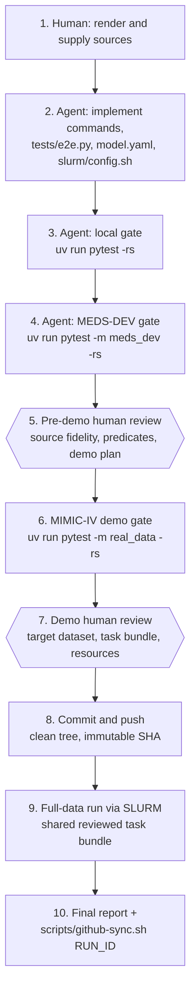

# Workflow: from render to full-data run

A port moves through a fixed sequence of gates. Each automated gate must pass before the next starts, with
human reviews before the demo and before full-data execution. The generated repository's
`docs/IMPLEMENTATION_GUIDE.md` is the authority for the ordered gates and their evidence; this page explains
what each gate is for.



## 1. Render

```bash
uv tool install copier
copier copy --trust https://github.com/florian6973/MEDS_algorithm_template ../my-meds-algorithm
```

Copier asks for the algorithm name and slug, the **profiles**, whether MEDS-DEV commands should pass
predicates, and the implementation source (paper and/or repository). The answers are recorded in
`.copier-answers.yml`, so `copier update` can bring later template changes in.

The generated commands are deliberately stubs: `STUB_PROFILES = set(PROFILES)` in `src/<slug>/<slug>.py` makes the
end-to-end tests skip with an explicit `algorithm_stub` reason until the real algorithm runs.

## 2. Implement

### Using an agent for automated implementation

Open a coding agent, such as Claude, in the **generated algorithm repository** and give it the
[copyable algorithm-implementation prompt](#copyable-algorithm-implementation-prompt) below. Replace every
placeholder with the source paper or repository, generated repository path, target dataset and revision,
and reviewed task-bundle location (or explicitly state that the bundle is not yet available). Supply
relevant source configurations and checkpoint references as well. Select the repository's profiles
when rendering; a single implementation can support several profiles through their separate
`algorithms/<profile>/model.yaml` files.

The template supplies instructions, interfaces and executable checks. It does **not** launch an agent
or run an unattended implementation service. The prompt works as ordinary agent input and includes
the Ponytail implementation principles; installing a separate agent plugin is not required.

| Stage | Agent's work | Human's responsibility |
|---|---|---|
| Handoff | Read `AGENTS.md`, `SPEC.md`, `README.md` and `docs/IMPLEMENTATION_GUIDE.md`; inspect the paper, source code and configurations; identify missing evidence. | Supply the intended source, profiles and dataset context; resolve scientific choices the source leaves ambiguous. |
| Implementation | Implement the algorithm and every declared profile's commands, descriptors, fixture adapter and primary-behavior tests. Reuse `meds-algorithm` for shared contract behavior. Record source fidelity and deviations in `IMPLEMENTATION_REPORT.md`. | Resolve missing inputs or consequential departures from the source when the agent raises them. |
| Automated verification | Run the local and MEDS-DEV gates, inspect failures, fix their causes and rerun the affected checks. Report exact commands, results, skips and remaining limitations. | Review the evidence, source fidelity, predicates and demo plan at the pre-demo gate. |
| Approved demo | After approval, run the MIMIC-IV demo gate and report execution, coverage and resource evidence. | Review the demo results and approve the full dataset, task bundle, access and resource plan separately. |
| Approved full run | Commit and push the completed implementation, run the approved SLURM job from its immutable commit, and prepare the final report and permitted structured run evidence. | Assess the scientific results and review the implementation and run evidence before merging. |

Within the implementation and verification stages, the agent should continue the edit–test–inspect
cycle without asking for approval for each routine change. It must surface missing source material,
credentials or task bundles as blockers, and wait at the two human review gates before the corresponding
data run. If work spans several sessions, the next agent reads the repository's implementation report
and recorded evidence, identifies the last completed gate, and resumes there. Approval must be explicit;
a passing test or an agent-written report does not grant it.

Tests must exercise the real algorithm behavior, including negative controls. The agent must not make a gate
pass by weakening checks, substituting fixture-only behavior, or hiding an unfinished profile with a
stub skip. Passing automated checks establishes the properties listed below; it does not independently
establish fidelity to the paper or scientific validity. Keep the detailed instructions in the shared
prompt and generated implementation guide rather than maintaining a separate prompt for each agent.

### Typed implementation and audit trail

The generated algorithm owns its named class and frozen configuration (for example, `RETAIN` and
`RETAINConfig` in the `retain` package). Profile ABCs require its
methods; typed request objects carry artifact references and permitted inputs. The shared runner owns
validation, measurement, staging, metadata and publication. Agents should implement cohesive algorithm
components with explicit dependencies, without mutable global runtime state, unnecessary wrappers or
copies of core utilities. Test config/request serialization and execution in a fresh process. See the
[shared architecture and UML](reference/architecture.md) for the implemented design.

### Implementation deliverables

Implement every command in the union of declared profiles, `tests/e2e.py`, `algorithms/<profile>/model.yaml`, and `slurm/config.sh`. In
`tests/e2e.py`, `run_e2e` runs the real profile on a small fixture to which it applies
`meds_algorithm.conformance.signal.add_split_canaries`, and returns the artifacts, the evaluated index and splits, the exact
external inputs, deterministic fixture seed and the canaries; `fitted_codes` reports every code the algorithm fitted a population
statistic for; `prepare_meds_dev_run` configures the MEDS-DEV run. Complete `tests/test_primary_behavior.py`,
which fails on purpose until it shows the algorithm's claimed behavior on a known signal, with a negative
control. Record every source element as ported, adapted or omitted in `IMPLEMENTATION_REPORT.md`.

## What each gate proves

| Gate | Proves | Does not prove |
|---|---|---|
| **Local** (`pytest -rs`) | the contract holds (command registry, manifests and `config_digest`, publication and rollback, measurements, key coverage, prediction schema), the real profile runs end to end on a synthetic fixture with no evaluated-split label read across a fresh full-lifecycle rerun (no label at all for zero-shot) and no statistic fitted on tuning or held-out subjects, and the primary behavior appears | anything about real data |
| **MEDS-DEV** (`-m meds_dev`) | the package installs in MEDS-DEV's isolated environment and the `algorithms/<profile>/model.yaml` command strings run | scale or real-data behavior |
| **Pre-demo review** (human) | the port is faithful to the source, predicates are interpreted correctly, the demo plan is sound | — |
| **MIMIC-IV demo** (`-m real_data`) | the pipeline survives real data: serialization, scale transitions, resources, key coverage on MEDS-DEV's `mortality/in_icu/first_24h` with MEDS-DEV's MIMIC-IV predicates | **algorithm quality**: the demo validates execution only (its held-out split is tiny and may have no positives) |
| **Demo review** (human) | the evidence is sufficient; target-dataset, task and predicate compatibility; access and resources for the full run | — |
| **Full data** (SLURM) | the scientific result on the shared task bundle | — |

A plain `pytest` run never clones MEDS-DEV or downloads data: the `meds_dev` and `real_data` tiers are
opt-in markers. Set `MEDS_DEV_DIR` to reuse a MEDS-DEV checkout and `MEDS_DEMO_DIR` to reuse a built
demo.

## The full-data run

- The cluster runs an **immutable commit** from a clean checkout: `slurm/submit.sh` refuses to submit from
  a dirty tree.
- The tasks come from a shared, reviewed task bundle for the target dataset, built once upstream: clinical tasks defined and extracted with [ACES](https://eventstreamaces.readthedocs.io/), or randomly sampled code-by-horizon tasks (generated with [meds-random-task-sampler](https://github.com/florian6973/meds-random-task-sampler) and selected with [meds-task-selection](https://github.com/florian6973/meds-task-selection)), containing each task's definition and its per-task index and labels. Zero-shot runs additionally need each task's ACES criteria.
  Every algorithm compared on a dataset uses the same bundle, and the bundle stays outside Git.
- Record the dataset name and revision, predicate provenance, bundle location, the commit of the tool that built the bundle,
  a digest of its task definitions, algorithm commit, configuration and job IDs.

## Reporting results

`scripts/github-sync.sh <run-id>` pushes only the run's structured evidence (`spec.yaml`, `result.yaml` and
the command manifests) on a `runs/<algorithm>/<run-id>` branch and opens a draft PR. Predictions, labels, data,
checkpoints, raw logs and metrics are never pushed; metrics come from MEDS-DEV's evaluation step. See
[Running a algorithm](running.md#run-results-and-github-sync) for the exact list.

--8<-- "README.md:implementation-prompt"
