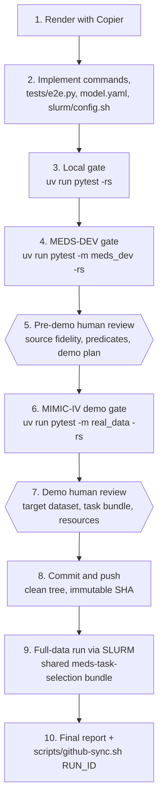

# Workflow: from render to full-data run

A port moves through a fixed sequence of gates. Each automated gate must pass before the next starts, and
two human reviews stand between the tests and any real data. The generated repository's
`docs/IMPLEMENTATION_GUIDE.md` is the authority for the ordered gates and their evidence; this page explains
what each gate is for.



## 1. Render

```bash
uv tool install copier
copier copy --trust https://github.com/florian6973/MEDS_model_template ../my-meds-model
```

Copier asks for the model name and slug, the **profile**, whether MEDS-DEV commands should pass
predicates, and the implementation source (paper and/or repository). The answers are recorded in
`.copier-answers.yml`, so `copier update` can bring later template changes in.

The generated commands are deliberately stubs: `IS_STUB = True` in `src/<slug>/commands.py` makes the
end-to-end tests skip with an explicit `model_stub` reason until the real model runs.

## 2. Implement

Implement every command of the profile, `tests/e2e.py`, `model.yaml`, and `slurm/config.sh`. In
`tests/e2e.py`, `run_e2e` runs the real profile on a small fixture to which it applies
`tests.signal.add_split_canaries`, and returns the artifacts, the evaluated index and splits, the exact
`predict` arguments and the canaries; `fitted_codes` reports every code the model fitted a population
statistic for; `prepare_meds_dev_run` configures the MEDS-DEV run. Complete `tests/test_primary_behavior.py`,
which fails on purpose until it shows the model's claimed behavior on a known signal, with a negative
control. Record every source element as ported, adapted or omitted in `IMPLEMENTATION_REPORT.md`.

## What each gate proves

| Gate | Proves | Does not prove |
|---|---|---|
| **Local** (`pytest -rs`) | the contract holds (command registry, manifests and `config_digest`, atomic publication, measurements, key coverage, prediction schema), the real profile runs end to end on a synthetic fixture with no label read on the prediction path and no statistic fitted on tuning or held-out subjects, and the primary behavior appears | anything about real data |
| **MEDS-DEV** (`-m meds_dev`) | the package installs in MEDS-DEV's isolated environment and the `model.yaml` command strings run | scale or real-data behavior |
| **Pre-demo review** (human) | the port is faithful to the source, predicates are interpreted correctly, the demo plan is sound | — |
| **MIMIC-IV demo** (`-m real_data`) | the pipeline survives real data: serialization, scale transitions, resources, key coverage on MEDS-DEV's `mortality/in_icu/first_24h` with MEDS-DEV's MIMIC-IV predicates | **model quality**: the demo validates execution only (its held-out split is tiny and may have no positives) |
| **Demo review** (human) | the evidence is sufficient; target-dataset, task and predicate compatibility; access and resources for the full run | — |
| **Full data** (SLURM) | the scientific result on the shared ten-task bundle | — |

A plain `pytest` run never clones MEDS-DEV or downloads data: the `meds_dev` and `real_data` tiers are
opt-in markers. Set `MEDS_DEV_DIR` to reuse a MEDS-DEV checkout and `MEDS_DEMO_DIR` to reuse a built
demo.

## The full-data run

- The cluster runs an **immutable commit** from a clean checkout: `slurm/submit.sh` refuses to submit from
  a dirty tree.
- The tasks come from the shared `work/` bundle produced by
  [meds-task-selection](https://github.com/florian6973/meds-task-selection) for the target dataset
  (`tasks.yaml` plus per-task inputs and labels). Every model compared on a dataset uses the same reviewed
  bundle. The bundle stays outside Git.
- Record the dataset name and revision, predicate provenance, bundle location, task-selection commit,
  `tasks.yaml` SHA-256, model commit, configuration and job IDs.

## Reporting results

`scripts/github-sync.sh <run-id>` commits the run's structured evidence (`spec.yaml`, `result.yaml`, copied
manifests) to an isolated `runs/<slug>/<run-id>` branch, pushes it, and opens a draft PR. It never commits
datasets, checkpoints, credentials or raw logs, and a failed push leaves the result committed locally.
