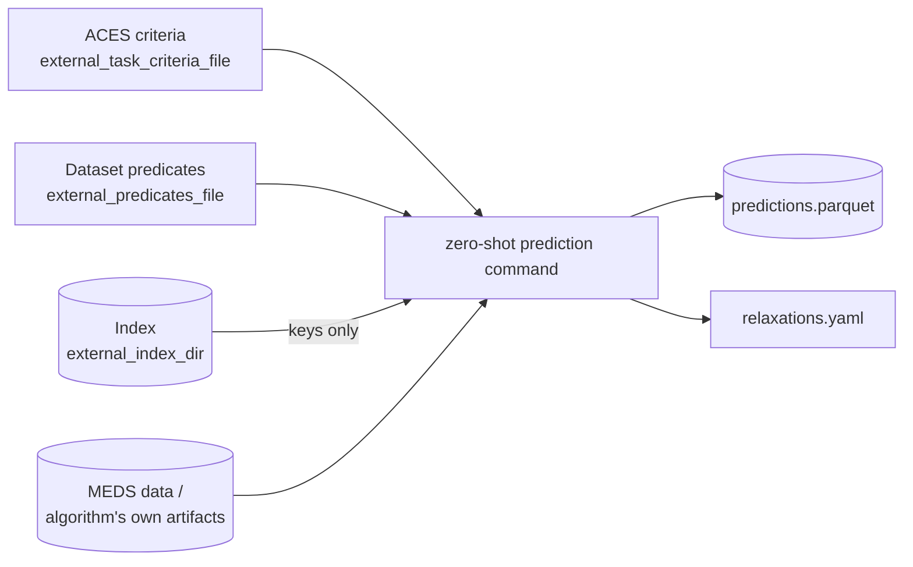

# Zero-shot in practice

A zero-shot algorithm answers a downstream task without fitting on that task's labels. This guide explains
the two [zero-shot profiles](profiles.md), task translation, and how to read their results.
The core contract owns the normative [task interface](reference/spec.md#24-task-specification-zero-shot-profiles),
[prediction requirements](reference/spec.md#31-zero-shot-prediction), and
[per-command arguments](reference/spec.md#step-arguments-and-artifacts). Examples here illustrate those rules.

## Who builds what

| Product | Owner |
|---|---|
| Cohort, prediction index and evaluation labels | Upstream task extraction, shared across algorithms |
| Algorithm query and any task approximations | The algorithm's task adapter |
| Probabilities for the supplied index | The algorithm's prediction command |

The task definition tells the algorithm what to predict for the supplied rows. It is not permission to
rebuild the cohort: doing so could change the population being compared or expose evaluation labels.

## What a zero-shot algorithm receives



| Input | Why |
|---|---|
| The **ACES task** (criteria + predicates) | without labels, this is the only way to know *what* to predict |
| The **index**, keys only | the rows to predict, built upstream; read with `read_index`, which never loads a label column |
| The algorithm's artifacts (and, for materialized algorithms, the raw MEDS dataset) | the history to predict from |

The task is the *original* task; adapting it to what the algorithm can answer is the algorithm's job.
The [MEDS-DEV integration](#meds-dev-integration) must supply it as `{task_criteria_path}`.

Criteria and predicates jointly identify a task. Criteria can leave dataset-specific event codes open;
the predicates file supplies those bindings. Changing the bindings changes the task's meaning, even
when its criteria are unchanged. The task semantics digest therefore covers both files.

## Direct queries or generated trajectories

| | `zero_shot_direct` | `zero_shot_materialized` |
|---|---|---|
| Algorithm behavior | Answers a query, such as a hazard or code-in-window probability | Generates possible futures |
| Typical example | A time-to-event or code-query algorithm | An autoregressive EHR generator |
| Prediction | Translates the task into a query, then decodes algorithm outputs | Evaluates the task on history plus generated futures |
| Main approximation to inspect | Query expressiveness and decoding assumptions | Sampling, truncation and generation policies |

Only the prediction command is task-conditioned. In `zero_shot_materialized`, `infer_trajectories` never receives
the task and records `semantics_digest: null`. Reuse across tasks still requires compatible history,
index, generation settings, and sufficient trajectory coverage for the requested windows.

For a direct algorithm, an encode → algorithm → decode adapter is a useful internal design: encode the task
into a supported query, run the algorithm, and decode keyed probabilities. Keep query and decoding evidence
with the predictions so reviewers can inspect what was answered. These internal class boundaries and
the `ZeroShotTranslator` sketch in the generated implementation guide are recommendations, not a
required framework. Neither the template nor core requires an aces-relaxations dependency.

The core reader projects key columns at I/O, but using that helper alone does not establish that the
whole algorithm is label-blind. Conformance must cover the preceding stages and any other reads, with
controlled randomness when comparing sampling-based runs; see [conformance](reference/spec.md#8-conformance).

## Relaxations: what the algorithm actually answered

Most algorithms cannot answer an arbitrary ACES task exactly. A time-to-event algorithm cannot express
"no discharge in the next 24h *and then* death before ICU discharge"; a code-in-window algorithm cannot express
"sodium below 135" when its vocabulary only has decile bins. They answer a **related** question. The
`relaxations.yaml` ledger states which one, so a reader can separate *algorithm error* from *relaxation error*.

```yaml
query_language: MOTOR first-occurrence time-to-event over task-head codes   # required
decoded_quantity: P(any of {MEDS_DEATH} first occurs before the first of {ICU_DISCHARGE, MEDS_DEATH})  # required
exact: false                                                                # required
steps:                                                                      # free-form, recommended
  - {name: normalize, kind: label_preserving, direction: exact, detail: re-rooted at the prediction time}
  - {name: label_only, kind: algorithm_assumption, direction: unknown, detail: dropped 2 criteria branches}
```

`exact: true` claims that the decoded quantity *is* the requested label's probability under the algorithm. The
recommended step vocabulary separates three kinds of difference:

| `kind` | Where it comes from | Effect on labels | Typical `direction` |
|---|---|---|---|
| `label_preserving` | a rewrite proven not to change any label on cohort rows (`normalize`, `require_bounding_events`, re-anchoring) | none | `exact` |
| `approximation` | a task rewrite with a known effect (`simplify_constraints`, `last_link_target`, a value threshold mapped onto bins) | changes labels in a stated direction | `weakening` (more positives) or `strengthening` (fewer) |
| `algorithm_assumption` | what the query language forces (vocabulary restriction, dropping criteria, independence between codes) | depends on the data | usually `unknown` |

Rules: a algorithm **must not** omit a step because it is expected to be small, and it **must raise** rather
than answer a task it cannot pose — the command fails and writes no predictions.

Two cases deserve particular scrutiny: a criterion sharing codes with the label cannot simply be
assumed independent of it, and a same-timestamp conjunction is not equivalent to both codes occurring
somewhere in a window. Record such substitutions explicitly rather than hiding them in decoding.

### What ledgers look like for three kinds of algorithm

Illustrative ledgers for MEDS-DEV's `mortality/in_icu/first_24h` and an abnormal-lab task. They show what a
reader should expect from each kind of algorithm, not values to copy.

#### Code-in-window query algorithm (direct)

For example EveryQuery. Its windows can start after a delay or at an event and end at a duration or a
bound event, so much of the task maps exactly. The algorithm is asked *P(death in (t₀ + 1 day, next ICU
discharge) | no ICU discharge, death or ICU admission in the first day)*. `exact: false`.

| Step | Kind | Direction |
|---|---|---|
| re-anchor the trigger-rooted `gap` window on the prediction time | label_preserving | exact |
| normalize | label_preserving | exact |
| remove death from the window's end event (`discharge_or_death`) | approximation | exact except on timestamp ties (strengthening) |
| criteria that hold on every cohort row, given to the algorithm as answered conditions | label_preserving | exact |
| a criterion spanning several codes, which cannot be given as a condition, dropped | algorithm_assumption | unknown |

#### Time-to-event algorithm (direct)

For example MOTOR. The algorithm has hazards for a fixed vocabulary of codes, so predicates are restricted
to that vocabulary and criteria branches are dropped. On an abnormal-lab task such as hyponatremia, the
`< 135 mEq/L` threshold cannot be expressed over codes without values and the "measured at least once"
criterion is dropped, so the decoded quantity becomes *P(any sodium measurement in the next 24h)*.

| Step | Kind | Direction |
|---|---|---|
| require_bounding_events, normalize | label_preserving | exact |
| vocabulary restriction (value bounds dropped) | algorithm_assumption | weakening |
| drop criteria branches | algorithm_assumption | unknown |
| single label window promoted to the prediction time (time-to-event stationarity) | approximation / algorithm_assumption | unknown unless exact |
| decode `and`/`or` under independence | algorithm_assumption | unknown |

#### Autoregressive generator (materialized)

For example MEDS-EIC-AR. The task is evaluated as written on real history plus each sampled future, so
the only intrinsic step is the Monte Carlo estimate. Effects that change the answer are recorded when
they happen: samples that end before the task resolves (ACES would count them as negatives), generated
events that land before the prediction time, samples that violate a future criterion (rejecting them
estimates *P(label | criteria hold)*), and rows with no usable sample (handled by a declared policy that
lists their keys).

## Windows that straddle the prediction time

Many MEDS-DEV tasks anchor their windows at the **trigger** (e.g. ICU admission), not at the prediction
time. In `mortality/in_icu/first_24h`, the prediction time is `trigger + 24h`, but the `gap` window spans
`(trigger, trigger + 48h]` and the label window hangs off its end:

```text
trigger
├── (+1 day) input.end            ← prediction time
└── (+2 days) gap.end             (no ICU admission, discharge or death)
    └── (next discharge or death) target.end   ← label: death
```

The first half of `gap` is past history (already enforced when the cohort was extracted); the second half
is a real condition on the future. A structural future-only check can reject this layout; a rewrite
that treats the whole window as past can instead discard its future condition. Test both cases against
the adapter's pinned task-library revision, including analogous `no_discharge` windows in lab tasks.

The fix is a **re-anchoring** step: a trigger-rooted window ending at `trigger + L` with `L > Δ` (where the
prediction time is `trigger + Δ`) becomes `(prediction time, prediction time + (L − Δ)]`; "never"
constraints can be retained over the remaining future interval. Other constraints require individual
analysis: the past portion may already satisfy them, but removing a remaining future requirement would
change the task. Claim label preservation only after checking the rewrite on the same cohort keys.
Generic, proven rewrites belong in the task library; algorithm-specific assumptions belong in the adapter.
Materialized algorithms can evaluate the original task on real history plus generated futures.

## Adapters are algorithm-specific

Translating an ACES task into a algorithm's query language is algorithm-specific, so it lives with the algorithm, not
in the template:

- **Task rewriting library**, such as aces-relaxations: provides structural checks and rewrites with
  documented semantic effects. Verify the available API and guarantees at the pinned revision.
- **aces-to-&lt;algorithm&gt;** (algorithm-specific): chooses which rewrites and assumptions the query language
  forces, runs the algorithm, decodes probabilities, and writes the ledger. aces-to-motor (for MOTOR) is one
  example.

Pin aces-relaxations to an exact version or commit in the algorithm repository; the template does not depend
on it.

## MEDS-DEV integration

Each zero-shot descriptor in `algorithms/<profile>/model.yaml` uses `{task_criteria_path}` and
`{predicates_path}`. The MEDS-DEV revision used to execute it must support these placeholders and pass
the original task definition, not a algorithm-specific relaxation. Check that capability before launching
the run; the template's integration helper records the revision used by its tests.

`{labels_dir}` can also supply `external_index_dir`: the algorithm reads only its key columns for scoring.
This does not require generating a second physical dataset. The evaluation-only truth join happens
after scores are fixed, as specified in the [core contract](reference/spec.md#step-arguments-and-artifacts).
For SLURM, supply `TASK_CRITERIA_FILE` and the task predicate binding through the generated configuration;
see [running a algorithm](running.md).

## Reading zero-shot results

- Predictions are scored against the **requested** task's labels; the relaxation is part of the algorithm.
- Compare algorithms on the same task with their ledgers side by side: a algorithm that answers an easier,
  relaxed question can look better or worse for reasons unrelated to its quality.
- A useful extra analysis for direct algorithms: extract the *relaxed* task's labels with
  `aces_relaxations.extract_at` on the same index and report performance against both label sets.
