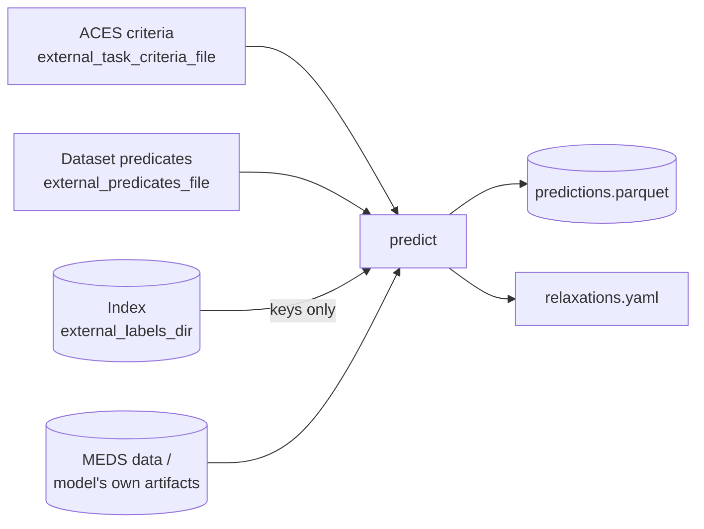

# Zero-shot in practice

A zero-shot model predicts a task it was never trained on. The template supports it through two profiles
(see [direct vs materialized](profiles.md#direct-vs-materialized-the-distinction-that-matters)). This page
explains what such a model receives, what it must publish, and how to read its results. The
[design notes](ZERO_SHOT.md) go deeper into the reasoning and the MOTOR mapping.

## What a zero-shot model receives



| Input | Why |
|---|---|
| The **ACES task** (criteria + predicates) | without labels, this is the only way to know *what* to predict |
| The **index**, keys only | the rows to predict, built upstream; read with `read_index`, which never loads a label column |
| The model's artifacts (and, for materialized models, the raw MEDS dataset) | the history to predict from |

The task is the *original* task. MEDS-DEV forwards it unchanged as `{task_criteria_path}`; adapting it to
what the model can answer is the model's job.

## What is enforced, and what is guidance

| Enforced by the contract and its tests | Guidance only |
|---|---|
| `predict` receives `external_task_criteria_file` and validates it before expensive work | building the translation on [aces-relaxations](https://github.com/McDermottHealthAI/aces-relaxations) |
| task provenance and `semantics_digest` in the task-conditioned manifest | the encode → model → decode shape (the `ZeroShotTranslator` sketch in the generated guide) |
| the index is read without label columns | the `kind` / `direction` vocabulary for ledger steps |
| complete, unique prediction keys | |
| a `relaxations.yaml` with `query_language`, `decoded_quantity` and `exact` | |

Only `predict` is task-conditioned, in both profiles. In `zero_shot_materialized`, `infer` never receives
the task and records `semantics_digest: null`, so its output can be reused for any task over the same index.

## Relaxations: what the model actually answered

Most models cannot answer an arbitrary ACES task exactly. A time-to-event model cannot express
"no discharge in the next 24h *and then* death before ICU discharge"; a code-in-window model cannot express
"sodium below 135" when its vocabulary only has decile bins. They answer a **related** question. The
`relaxations.yaml` ledger states which one, so a reader can separate *model error* from *relaxation error*.

```yaml
query_language: MOTOR first-occurrence time-to-event over task-head codes   # required
decoded_quantity: P(any of {MEDS_DEATH} first occurs before the first of {ICU_DISCHARGE, MEDS_DEATH})  # required
exact: false                                                                # required
steps:                                                                      # free-form, recommended
  - {name: normalize, kind: label_preserving, direction: exact, detail: re-rooted at the prediction time}
  - {name: label_only, kind: model_assumption, direction: unknown, detail: dropped 2 criteria branches}
```

`exact: true` claims that the decoded quantity *is* the requested label's probability under the model. The
recommended step vocabulary separates three kinds of difference:

| `kind` | Where it comes from | Effect on labels | Typical `direction` |
|---|---|---|---|
| `label_preserving` | a rewrite proven not to change any label on cohort rows (`normalize`, `require_bounding_events`, re-anchoring) | none | `exact` |
| `approximation` | a task rewrite with a known effect (`simplify_constraints`, `last_link_target`, a value threshold mapped onto bins) | changes labels in a stated direction | `weakening` (more positives) or `strengthening` (fewer) |
| `model_assumption` | what the query language forces (vocabulary restriction, dropping criteria, independence between codes) | depends on the data | usually `unknown` |

Rules: a model **must not** omit a step because it is expected to be small, and it **must raise** rather
than answer a task it cannot pose — the command fails and writes no predictions.

### What ledgers look like for three kinds of model

Illustrative ledgers for MEDS-DEV's `mortality/in_icu/first_24h` and an abnormal-lab task. They show what a
reader should expect from each kind of model, not values to copy.

=== "Code-in-window query model (direct)"

    For example EveryQuery. Its windows can start after a delay or at an event and end at a duration or a
    bound event, so much of the task maps exactly. The model is asked *P(death in (t₀ + 1 day, next ICU
    discharge) | no ICU discharge, death or ICU admission in the first day)*. `exact: false`.

    | Step | Kind | Direction |
    |---|---|---|
    | re-anchor the trigger-rooted `gap` window on the prediction time | label_preserving | exact |
    | normalize | label_preserving | exact |
    | remove death from the window's end event (`discharge_or_death`) | approximation | exact except on timestamp ties (strengthening) |
    | criteria that hold on every cohort row, given to the model as answered conditions | label_preserving | exact |
    | a criterion spanning several codes, which cannot be given as a condition, dropped | model_assumption | unknown |

=== "Time-to-event model (direct)"

    For example MOTOR. The model has hazards for a fixed vocabulary of codes, so predicates are restricted
    to that vocabulary and criteria branches are dropped. On an abnormal-lab task such as hyponatremia, the
    `< 135 mEq/L` threshold cannot be expressed over codes without values and the "measured at least once"
    criterion is dropped, so the decoded quantity becomes *P(any sodium measurement in the next 24h)*.

    | Step | Kind | Direction |
    |---|---|---|
    | require_bounding_events, normalize | label_preserving | exact |
    | vocabulary restriction (value bounds dropped) | model_assumption | weakening |
    | drop criteria branches | model_assumption | unknown |
    | single label window promoted to the prediction time (time-to-event stationarity) | approximation / model_assumption | unknown unless exact |
    | decode `and`/`or` under independence | model_assumption | unknown |

=== "Autoregressive generator (materialized)"

    For example MEDS-EIC-AR. The task is evaluated as written on real history plus each sampled future, so
    the only intrinsic step is the Monte Carlo estimate. Effects that change the answer are recorded when
    they happen: samples that end before the task resolves (ACES would count them as negatives), generated
    events that land before the prediction time, samples that violate a future criterion (rejecting them
    estimates *P(label | criteria hold)*), and rows with no usable sample (handled by a declared policy that
    lists their keys).

## Windows that straddle the prediction time

Many MEDS-DEV tasks anchor their windows at the **trigger** (e.g. ICU admission), not at the prediction
time. In `mortality/in_icu/first_24h`, the prediction time is `trigger + 24h`, but the `gap` window spans
`(trigger, trigger + 48h]` and the label window hangs off its end:

```text
trigger
├── (+1 day) input.end            ← prediction time
└── (+2 days) gap.end             (no ICU admission, discharge or death)
    └── (next discharge or death) target.end   ← label: death
```

The first half of `gap` is past history (already enforced when the cohort was extracted); the second half
is a real condition on the future. aces-relaxations' future-only check is structural — the label window
must hang off the prediction time — so it rejects this task, and for the seven `abnormal_lab/*/first_24h`
tasks `normalize` silently drops the similar `no_discharge` window.

The fix is a **re-anchoring** step: a trigger-rooted window ending at `trigger + L` with `L > Δ` (where the
prediction time is `trigger + Δ`) becomes `(prediction time, prediction time + (L − Δ)]`; "never"
constraints are kept (they held over the whole window), others are dropped (the past half may have
satisfied them). On every cohort row the label is unchanged. Direct adapters currently carry this step
themselves; it is model-independent and belongs upstream in aces-relaxations. Materialized models do not
need it: they evaluate the original task on real history plus generated futures.

## Adapters are model-specific

Translating an ACES task into a model's query language is model-specific, so it lives with the model, not
in the template:

- **aces-relaxations** (generic, pre-1.0): decides whether a task can be posed (`is_future_only`,
  `degeneracies`) and provides rewrites with known effects (`normalize`, `simplify_constraints`,
  `last_link_target`).
- **aces-to-&lt;model&gt;** (model-specific): chooses which rewrites and assumptions the query language
  forces, runs the model, decodes probabilities, and writes the ledger. aces-to-motor (for MOTOR) is one
  example.

Pin aces-relaxations to an exact version or commit in the model repository; the template does not depend
on it.

## Reading zero-shot results

- Predictions are scored against the **requested** task's labels; the relaxation is part of the model.
- Compare models on the same task with their ledgers side by side: a model that answers an easier,
  relaxed question can look better or worse for reasons unrelated to its quality.
- A useful extra analysis for direct models: extract the *relaxed* task's labels with
  `aces_relaxations.extract_at` on the same index and report performance against both label sets.
